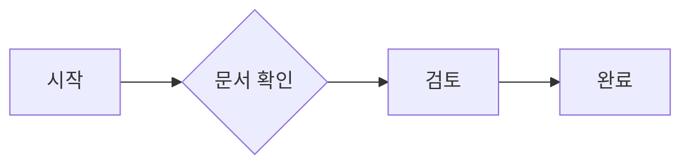
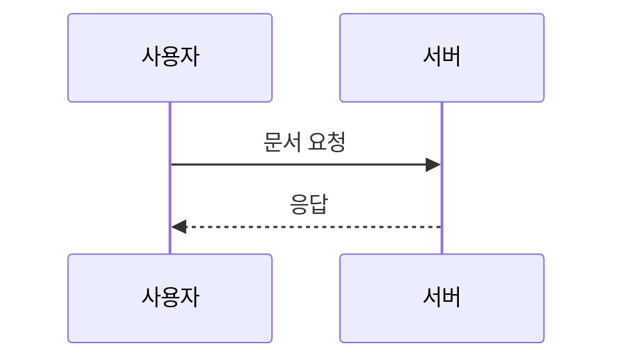

# Markdown 예제

> 같은 문서를 업무 미리보기·변경 상세·명세 조회에서 확인합니다.

1. 문서를 읽습니다.
2. 표와 다이어그램을 확인합니다.

- [x] 읽기 전용 완료 항목
- [ ] 읽기 전용 미완료 항목

**강조**와 *기울임*, ~~취소선~~, `인라인 코드`.

---

| 왼쪽 | 가운데 | 오른쪽 | 긴 내용 |
| :--- | :---: | ---: | --- |
| 항목 | 상태 | 123 | 문서-영역보다-넓은-내용은-표-안에서-가로로-스크롤하여-전체를-확인합니다 |

[외부 링크](https://example.com) · [메일](mailto:dev@example.com) · https://example.com






```unknown
알 수 없는 언어는 <원문 코드> 그대로 표시합니다.
```
